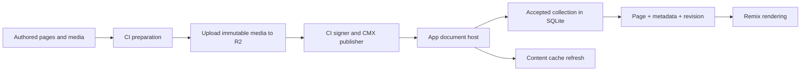

# Architecture

This production site is also a reference for similar CMX applications. The app
hosts documents; CI publishes them; both consume shared contracts. CMX integration
mechanics that could move upstream are recorded in
[research](research/cmx-publication-candidates.md).

## Ownership

| Location                                                                                                 | Owns                                                                                                                                                                               |
| -------------------------------------------------------------------------------------------------------- | ---------------------------------------------------------------------------------------------------------------------------------------------------------------------------------- |
| `app/document-host/`                                                                                     | Incoming authentication, replay protection, complete-collection acceptance, SQLite storage, coherent reads, and cache refresh. [Module interface](../app/document-host/README.md). |
| `scripts/publishing/`                                                                                    | CI publishing configuration, private-key signing, and outgoing transport. The command is `npm run content:publish`.                                                                |
| `contracts/`                                                                                             | The document collection, metadata types and validation, publication endpoint, and signed-request format. Imports neither app nor publishing code.                                  |
| `content/`                                                                                               | Authored pages, Song and Release metadata, people, public paths, navigation, redirects, and source media. [Authoring](../content/README.md).                                       |
| `content/contract/` + `cmx.config.ts`                                                                    | External component props and their mapping to app implementations. Implementation paths are relative to generated `.cmx/environment.ts`.                                           |
| `scripts/compile-cmx.ts`, `scripts/build-*.ts`, `scripts/extract-palettes.ts`, `scripts/upload-media.ts` | Content compilation, metadata/media preparation, app asset building, and upload. These are separate commands; preparation ordering is still visible to callers.                    |
| `app/content-rendering.ts`, `app/cmx-components.ts`, `app/content-components.tsx`                        | CMX rendering and native Remix presentation. The component implementations are still concentrated in one large file.                                                               |
| `app/page.tsx`, `app/navigation.tsx`, `app/router.tsx`                                                   | Page shell, SEO, navigation, and public HTTP behavior.                                                                                                                             |
| `app/newsletter*.ts*`                                                                                    | Newsletter HTTP handling, sessions/storage, delivery, and the private form island. [Behavior and configuration](newsletter.md).                                                    |

## Runtime and publishing

The host accepts the complete collection atomically and owns pending cache refresh.
A publishing retry lets the host finish pending cache refresh. Public page rendering
uses a snapshot so page content and navigation come from the same revision.
Website deployments preserve both content and newsletter Durable Object state.
[Publishing](content-publishing.md) covers authentication and release behavior.

## Entrypoints and generated output

| Entrypoint                | Content source                                                       |
| ------------------------- | -------------------------------------------------------------------- |
| `app/worker.ts`           | Production: the accepted collection in the persistent document host. |
| `app/local-worker.ts`     | Local authoring: prepared `.generated/publication.json`.             |
| `tests/website-worker.ts` | Website checks: synthetic documents from `tests/host-fixture.ts`.    |

All three use the same Worker composition. The local and test entrypoints provide
their source explicitly. Production builds contain no authored documents.

`.cmx/` holds compilation output and the generated implementation environment.
`.generated/` holds prepared routes, media metadata/files, the publication, and
the browser asset manifest. `dist/` holds static assets. A fresh checkout has none
of these; follow the [setup sequence](../README.md#start-locally) before full checks.
Website-only work uses `npm run build:app` followed by `npm run check:website`.

## Adapting this site

Start with `content/` for authored material and public paths, `content/contract/`
for reusable content props, and the app rendering files for presentation. Site
identity currently spans `app/page.tsx`, `app/navigation.tsx`, `app/assets/`,
newsletter sender configuration, and content metadata. It is not centralized in a
template configuration module.

Deployment-specific names and origins live in `wrangler.jsonc`, both workflows,
and the publishing/media scripts. Use the setup references in the
[README](../README.md#deployment) when adapting credentials and hosting. These
site-specific choices stay here while generic CMX integration candidates are
evaluated upstream.
